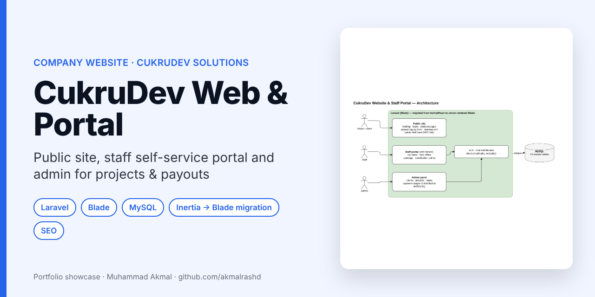
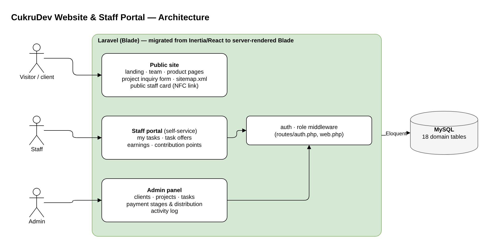
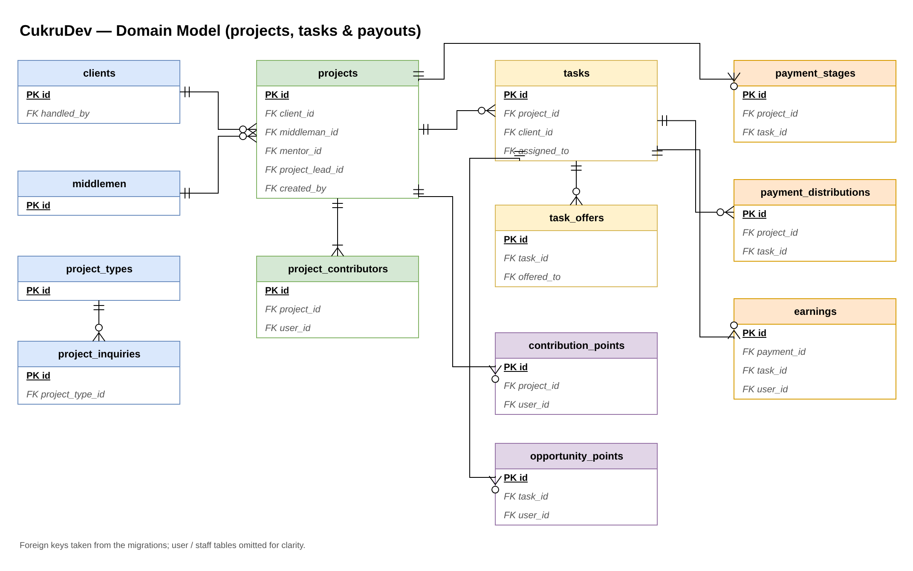

# CukruDev Solutions: Company Website and Staff Portal

> **Portfolio showcase.** Internal company system, so the source code is private.

**Company:** CukruDev Solutions (student startup under the Faculty of Computing, UMPSA)  
**Role:** Sole developer · **Period:** June – October 2026 (28 commits)

  

---

## What it does

One Laravel app with three faces:

| Area | Features |
|---|---|
| **Public site** | Company landing page, team section, product pages, project inquiry form, public staff profile cards (shared by NFC tag), dynamic `sitemap.xml`, Search Console verification |
| **Staff portal** | Self-service: assigned tasks, task offers, earnings, contribution points |
| **Admin panel** | Clients, middlemen, projects and leads, tasks, payment stages, payment distribution between contributors, activity log |

## System design

### Architecture

### Domain model: projects, tasks and payouts

## Engineering highlights

- **Fair payouts as data:** payment stages and distributions are tied to projects and tasks, and every contributor's earnings and points are recorded, so the team can see who did what.
- **Migration from Inertia/React to Blade:** I moved the public, auth, portal and admin pages to server-rendered Blade in stages, then removed the Node build entirely. The result is a simpler deploy with no Node build step.
- SEO basics: sitemap, verification, clean URLs.

## How I used AI tools

AI coding assistants helped with boilerplate, the step-by-step migration and debugging. The data model and business rules for payouts came from the CukruDev team, and I reviewed and tested the changes.

## Contact

**Muhammad Akmal bin Mohd Rashid**: Software Engineering student, UMPSA.  
Open to a 6-month internship (22 February to 7 August 2027).  
📧 work.akmalrashd@gmail.com · 💼 [linkedin.com/in/akmalrashd](https://www.linkedin.com/in/akmalrashd)
